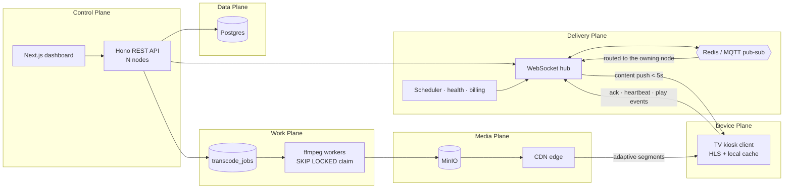

# Brandcast TV — Cloud Digital Signage Platform

A complete, multi-tenant digital signage SaaS. Turns any smart TV into a centrally
managed marketing display: pair with a 4-digit code, assign playlists, push promotions
instantly, and monitor screen health from anywhere.

Implements the Brandcast TV PRD v1.0 end to end — all three roadmap phases — on
**Next.js 16.3 + HeroUI 3 + TypeScript 7** for the console and **Hono + Drizzle +
Postgres** for the data plane, with **MinIO** object storage behind a CDN and
**adaptive multi-bitrate** media delivery.

## Quick start

### With Docker (recommended)

```bash
cp .env.example .env                            # then set JWT_SECRET
docker compose up -d                            # postgres, redis, minio, app
docker compose --profile seed run --rm seed     # demo data (optional)
```

| Surface | URL |
|---|---|
| Dashboard | <http://localhost:4000> |
| TV player | <http://localhost:4000/tv> |
| MinIO console | <http://localhost:9011> |

Host ports are offset on purpose — Postgres on 5433, Redis on 6380, MinIO on 9010 —
so the stack does not fight whatever else is already on the standard ones. Two
optional profiles: `--profile edge` puts a caching nginx in front of MinIO on :9020,
which is what `CDN_BASE_URL` should point at, and `--profile workers` runs dedicated
transcode workers — `docker compose --profile workers up -d --scale worker=3`.

### Without Docker

Requires [Bun](https://bun.sh) 1.4+, ffmpeg, and a Postgres to point at.

```bash
docker compose up -d postgres     # or set DATABASE_URL to your own
bun install
bun run seed                      # applies migrations, then loads demo data
bun run build                     # compiles the Next.js app
bun start                         # http://localhost:4000
```

Migrations run at boot, so a fresh database needs no extra step. Media falls back to
local disk when MinIO is unreachable, so object storage is optional in development.

### Demo accounts (password `password123`)

| Role | Email | Can do |
|---|---|---|
| Owner | owner@acme.test | Everything incl. billing |
| Admin | admin@acme.test | All except billing |
| Branch Manager | manager@acme.test | Only assigned branches |
| Content Editor | editor@acme.test | Author content, cannot publish |
| Viewer | viewer@acme.test | Read only |
| Superadmin | superadmin@brandcast.tv | Platform console (`superadmin123`) |

### See it work in 60 seconds

1. Open the **TV player** in one tab — it shows a 4-digit code with a countdown.
2. Sign in to the **dashboard** as the owner, go to **Screens → Add New Screen**.
3. Enter the code, name the screen, pick a playlist, click **Pair & go live**.
4. Upload an MP4 in **Media**. It is transcoded into a 4-rung HLS ladder in the
   background; the chip shows `queued → processing → ready`.
5. Kill the server: the TV keeps looping from its local cache and reconnects.

## Stack

| Layer | Choice | Why |
|---|---|---|
| UI | Next.js 16.3 (App Router) + React 19 | one framework for dashboard and TV client |
| Components | HeroUI 3 | React Aria underneath, so dialogs and menus are accessible by construction |
| Icons | HugeIcons (stroke) | one typed registry; no emoji or unicode glyphs as icons |
| Types | TypeScript 7 (`tsgo`, native Go compiler) | full strict mode, ~10x faster checks |
| Runtime | Bun 1.4 | one toolchain for install, test and serve; runs the TypeScript data plane with no build step |
| API | Hono + `ws` | Web-standard `Request`/`Response` handlers on the Node adapter, so one process owns REST, WebSockets and the Next handler |
| Data | Postgres 16 + Drizzle | one typed schema file generates the migrations; `FOR UPDATE SKIP LOCKED` gives the job queue its worker pool |
| Fan-out | Redis or MQTT pub/sub | a publish reaches whichever node holds the screen's socket |
| Storage | MinIO (S3 API) | CDN origin for media; local-disk fallback |
| Transcoding | ffmpeg | HLS ladder + MP4 fallbacks + responsive images |

## Design

The console is built as a **macOS desktop application**, not a web dashboard. Every
route is a window scene: traffic lights and a translucent titlebar, a source list on
the leading edge, and grouped inset content in the middle. The reference is Apple's
own utilities: System Settings, Console, App Store Connect.

- **Appearance follows the system.** `System` / `Light` / `Dark`, switched from a
  segmented control in the toolbar. A blocking inline script applies the class before
  first paint, so there is no flash of the wrong appearance, and `System` re-resolves
  live when macOS appearance changes.
- **Apple's semantic colour vocabulary.** Tokens are named for their role
  (`label`, `separator`, `field-border`, `systemBlue`) rather than for a palette
  position, and the same names carry different values per appearance, so a component
  is written once. Colour strategy is Restrained: tinted neutrals plus one accent,
  and semantic colour only ever means state.
- **Native type.** The system font stack (SF Pro on macOS) at AppKit's control sizes:
  13px body, 28px controls, 6px button corners, tabular numerals in every table.
- **One icon family.** `@hugeicons/react` behind a typed registry at
  `web/src/components/global/icon.tsx`. Views pass an intent name (`"publish"`,
  `"offline"`), never a glyph, so a typo is a compile error and the set cannot drift.

`PRODUCT.md` holds the strategic context; `DESIGN.md` holds the visual system. Four
tests in `tests/nfr.test.js` enforce the invariants: no unicode glyphs as icons, no
icon imports outside the registry, both appearances defined, and no hardcoded hex
colours in a view.

## Architecture

Every plane scales sideways. Nothing but the database is a single instance, and no
node holds state another node needs.



```
src/db/        schema (every table, one file) · client (pool, migrations)
src/lib/       auth+RBAC · plans · bus · hub · content · jobs · queue · storage ·
               transcode · billing · ratelimit · totp
src/routes/    accounts · content · screens · schedules · insights · billing · superadmin
drizzle/       generated migrations, applied at boot
web/src/lib/   types · api client · resources (registry) · i18n · adaptive
web/src/app/   login · accept-invite · tv · dashboard/* (13 views)
tests/         e2e · features · nfr · media
```

### Scaling out

| Concern | Single node | Fleet |
|---|---|---|
| Sessions | in-process map | same map, plus a per-screen bus topic subscribed only while this node holds the socket |
| Presence | the socket itself | `screens.last_seen_at` in Postgres, which every node reads the same way |
| Renditions | in-process workers | `transcode_jobs` claimed with `FOR UPDATE SKIP LOCKED`; source read from object storage, so any node can run any job |
| Media | API streams it | CDN in front of MinIO; objects carry their own `Cache-Control` |
| Rate limits | in-process buckets | still per-node; the edge limiter is the real ceiling |

## Adaptive media delivery

Upload once; every screen gets the rendition it can actually play.

- **Video** → an HLS ladder capped at the source height (never upscaled):
  360p@800k, 480p@1.4M, 720p@3M, 1080p@6M, plus a progressive MP4 per rung for
  TVs without HLS, plus a poster frame.
- **Images** → 640/1280/1920/3840 wide, in WebP and JPEG (WebP only when the
  ffmpeg build provides an encoder).
- **On the device** → `hls.js` ABR seeded with the measured downlink, capped to
  the panel size. Where HLS is unavailable the client picks an MP4 by the same rule.

Measured behaviour (`tests/media.test.js`):

| Panel | Link | Chosen |
|---|---|---|
| 1080p | 1.5 Mbps | 360p |
| 1080p | 20 Mbps | 1080p |
| 720p | 50 Mbps | 720p (never exceeds the panel) |
| 1080p | 150 kbps | 360p (degrades, never fails) |

Playlists cache-bust every 10s; segments are immutable and cached for a year.
Set `CDN_BASE_URL` and screens fetch from the edge instead of the origin.

## Architectural guardrail

This repo follows `.claude/skills/architectural-guardrail`:

- **One registry.** `web/src/lib/resources.ts` drives permissions, plan limits,
  upgrade copy and the sidebar from a single object, so they cannot drift.
  `PermissionKey` is a derived template-literal union — `permission("screens", "pubish")`
  is a compile error.
- **The layout closes the gap.** Pages that render without an API call are guarded
  in `dashboard-shell.tsx` using the same registry the nav reads.
- **Org scoping is server-side.** `ctx.orgId` comes from the session, never from
  input, so a caller cannot reach another tenant's rows.
- **No `any`, no `as` casts, no `@ts-ignore`.** Every strict flag is on, including
  `noUncheckedIndexedAccess` and `exactOptionalPropertyTypes`.

## Feature coverage

**Phase 1 — MVP**: OTP pairing with countdown and expiry · Add New Screen ·
instant WebSocket push with Pending → Delivered → Rendered · offline cache and
delta sync · unpair with instant token revocation.

**Phase 2 — Multi-branch & scheduling**: Organization → Branch → Screen with
per-branch timezones · full RBAC enforced at the API layer · dayparting with
specificity-based conflict resolution · media library with version history ·
playlist builder · flash news ticker · health monitoring and alerts · bulk publish ·
rollback · self-serve billing with GST invoices.

**Phase 3 — Enterprise**: superadmin console · per-org feature flags ·
audit-logged support impersonation · content approval workflow · TOTP 2FA · SSO ·
uptime and content analytics with CSV export.

## Verification

```bash
docker compose up -d postgres   # the suites need a database to create theirs in
bun run test                    # 74 tests: API, features, non-functional, media
bun run typecheck               # tsc for the data plane, tsgo for the console
bun run lint
```

Tests run against a real server process, a real Postgres, real ffmpeg and real object
storage. Each suite creates its own database and drops it afterwards, so they neither
see each other's rows nor leave anything behind. They cover measured publish latency,
offline detection and recovery, tenant isolation, RBAC denials, plan limits, rate
limiting, the HLS ladder, and adaptive selection.

`TEST_DATABASE_URL` overrides where those databases are created;
`TEST_SERVER_STDIO=inherit` shows the server's own logs when a suite will not boot.

| PRD KPI | Target | Measured |
|---|---|---|
| Time to pair a screen | < 2 min | ~30 ms API round trip |
| Publish-to-display latency (P95) | < 5 s | ~75 ms |

## Configuration

`.env.example` is the annotated list. The ones that change behaviour:

| Variable | Default | Purpose |
|---|---|---|
| `DATABASE_URL` | — | **Required.** Postgres connection string |
| `PORT` | `4000` | HTTP port |
| `JWT_SECRET` | dev value | **Set in production** |
| `REDIS_URL` / `MQTT_URL` | empty | Cross-node fan-out. Empty means a single-process bus |
| `NODE_ID` | generated | Identifies this node in logs and `/api/admin/health` |
| `UPLOAD_DIR` | `uploads/` | Local media fallback |
| `MINIO_ENDPOINT` / `MINIO_PORT` | `localhost` / `9000` | Object storage |
| `MINIO_ACCESS_KEY` / `MINIO_SECRET_KEY` | `brandcast` / … | Credentials |
| `MINIO_BUCKET` | `brandcast-media` | Bucket name |
| `CDN_BASE_URL` | empty | CDN in front of MinIO |
| `CDN_PLAYLIST_MAX_AGE` | `10` | Seconds an edge may serve a playlist before revalidating |
| `STORAGE_DRIVER` | auto | `local` forces disk |
| `TRANSCODE_CONCURRENCY` | `cpus-1`, capped at 2 | Jobs per process. `0` makes the node enqueue-only |
| `OTP_TTL_MS` | `180000` | Pairing code lifetime |
| `OFFLINE_AFTER_MS` | `90000` | Missed-heartbeat threshold |
| `RATE_LIMIT_AUTH` | `10` | Login attempts / 15 min |
| `BILLING_GATEWAY` | auto | `manual` \| `stripe` \| `razorpay`; auto-detected from the keys |
| `STRIPE_SECRET_KEY` / `STRIPE_WEBHOOK_SECRET` | empty | Enables Stripe checkout and webhooks |
| `RAZORPAY_KEY_ID` / `_KEY_SECRET` / `_WEBHOOK_SECRET` | empty | Enables Razorpay |
| `PUBLIC_BASE_URL` | `http://localhost:4000` | Where a gateway returns the customer to |

## Security and accessibility

- **Rate limiting** on login, signup, reset and pairing, bucketed by IP *and*
  identity so one attacker cannot lock out an unrelated account.
- **Pairing tokens are device-bound**: `/api/pairing/status/:code` requires the
  caller's own `device_id`, so guessing a 4-digit code yields nothing.
- **WCAG 2.1 AA**: skip link, landmarks, `aria-current`, dialogs with focus
  trapping via React Aria, labelled controls, logical CSS properties so Arabic
  mirrors correctly, and `prefers-reduced-motion`. Body text sits at 15.8:1 contrast
  in light and 16.1:1 in dark; muted text at 5.9:1 and 7.2:1 (AA needs 4.5:1).
- **Status is never colour alone.** Every state pill pairs a semantic colour with an
  icon and a text label, so it survives deuteranopia and a bright showroom monitor.
- **Drag has a keyboard equivalent.** The playlist builder exposes move-up/move-down
  buttons beside every row, since drag-and-drop alone fails WCAG 2.1.
- **Localization** in English, Hindi, Tamil, Kannada and Arabic. `TranslationKey`
  is derived from the English dictionary, so a missing key in any locale fails the
  build rather than silently falling back.

## Image size

The runtime image ships only what runs: Next's traced standalone bundle plus the
data plane's production dependencies, on Alpine.

| Stage | Size |
|---|---|
| Naive (full `node_modules`, Debian) | 1.98 GB |
| Standalone output, Debian + Node | 1.05 GB |
| **Standalone output, Alpine + Bun** | **456 MB** |

Every dependency is pure JavaScript and Bun runs the TypeScript data plane directly,
so no compiler toolchain is needed in any runtime layer.

## Running it in production

**Database.** Postgres is the only store. `src/db/schema.ts` is the whole model;
`bun run db:generate` turns it into SQL under `drizzle/`, which is committed and
applied at boot behind an advisory lock, so several nodes starting together do not
race each other through the same migration.

**Fan-out.** Set `REDIS_URL` (or `MQTT_URL`) and run as many API nodes as you need. A
node subscribes to a screen's topic only while it holds that screen's socket, so a
publish is routed to the one node that can deliver it rather than broadcast to the
fleet. Presence across nodes is read from `screens.last_seen_at` — the heartbeat every
node already writes — rather than a second store that could disagree with the first.

**CDN.** Point `CDN_BASE_URL` at an edge in front of MinIO and screens stop touching
the origin. Objects are uploaded with their own `Cache-Control`: playlists revalidate
in seconds, segments and image variants are immutable for a year. The `edge` compose
profile runs that locally with nginx, and `X-Cache-Status` on the response says
whether a request was served from cache.

**Transcoding.** Jobs are rows in `transcode_jobs`, claimed with `FOR UPDATE SKIP
LOCKED`, so N workers across N nodes take N different jobs. The source is read from
object storage, not the uploading node's temp file, which is what lets any worker run
any job. Failures back off and retry; a worker that dies has its lease reclaimed.
Scale with `docker compose --profile workers up -d --scale worker=5`, and set
`TRANSCODE_CONCURRENCY=0` on the API nodes to hand the queue over entirely.

**Billing.** With `STRIPE_*` or `RAZORPAY_*` keys set, `POST /api/billing/subscribe`
does not change the plan — it opens a hosted checkout and returns the URL. The plan
changes when a signed webhook arrives at `/api/billing/webhooks/stripe` or
`/api/billing/webhooks/razorpay`. Signatures are verified over the raw body
(Stripe's timestamp is inside the signed data, so a captured request cannot be
replayed), and every event id is recorded before it is applied, so the gateways'
at-least-once delivery is safe. With no keys the service stays on the `manual`
gateway, where subscribe applies the change directly — the self-hosted and demo path.
No card data ever reaches this service.

**What is still per-node.** Rate-limit buckets and password-reset tokens live in
process. Both degrade safely across nodes — a limiter that counts per node is a
looser limit, not an absent one — but the edge or gateway limiter is the real
ceiling in front of a fleet.
