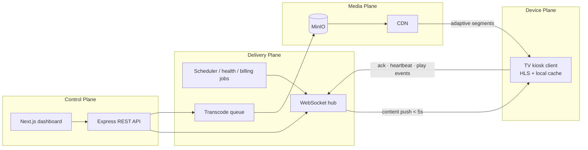

# Brandcast TV — Cloud Digital Signage Platform

A complete, multi-tenant digital signage SaaS. Turns any smart TV into a centrally
managed marketing display: pair with a 4-digit code, assign playlists, push promotions
instantly, and monitor screen health from anywhere.

Implements the Brandcast TV PRD v1.0 end to end — all three roadmap phases — on
**Next.js 16.3 + HeroUI 3 + TypeScript 7**, with **MinIO** object storage and
**adaptive multi-bitrate** media delivery.

## Quick start

### With Docker (recommended)

```bash
cp .env.example .env                            # then set JWT_SECRET
docker compose --profile seed run --rm seed     # demo data (optional)
docker compose up -d
```

| Surface | URL |
|---|---|
| Dashboard | <http://localhost:4000> |
| TV player | <http://localhost:4000/tv> |
| MinIO console | <http://localhost:9011> |

### Without Docker

Requires [Bun](https://bun.sh) 1.4+ and ffmpeg.

```bash
bun install
bun run seed
bun run build     # compiles the Next.js app
bun start         # http://localhost:4000
```

Media falls back to local disk when MinIO is unreachable, so the app runs standalone.

### Demo accounts (password `password123`)

| Role | Email | Can do |
|---|---|---|
| Owner | owner@acme.test | Everything incl. billing |
| Admin | admin@acme.test | All except billing |
| Branch Manager | manager@acme.test | Only assigned branches |
| Content Editor | editor@acme.test | Author content, cannot publish |
| Viewer | viewer@acme.test | Read only |
| Superadmin | superadmin@brandcast.tv | Platform console (`superadmin123`) |

### See it work in 60 seconds

1. Open the **TV player** in one tab — it shows a 4-digit code with a countdown.
2. Sign in to the **dashboard** as the owner, go to **Screens → Add New Screen**.
3. Enter the code, name the screen, pick a playlist, click **Pair & go live**.
4. Upload an MP4 in **Media**. It is transcoded into a 4-rung HLS ladder in the
   background; the chip shows `queued → processing → ready`.
5. Kill the server: the TV keeps looping from its local cache and reconnects.

## Stack

| Layer | Choice | Why |
|---|---|---|
| UI | Next.js 16.3 (App Router) + React 19 | one framework for dashboard and TV client |
| Components | HeroUI 3 | React Aria underneath, so dialogs and menus are accessible by construction |
| Types | TypeScript 7 (`tsgo`, native Go compiler) | full strict mode, ~10x faster checks |
| Runtime | Bun 1.4 | one toolchain for install, test and serve; ~11s installs |
| API | Express + `bun:sqlite` (WAL) + `ws` | one process owns REST, WebSockets and the Next handler; zero native addons |
| Storage | MinIO (S3 API) | CDN origin for media; local-disk fallback |
| Transcoding | ffmpeg | HLS ladder + MP4 fallbacks + responsive images |

## Architecture



```
src/lib/       db · auth+RBAC · plans · hub · content · jobs · storage · transcode
src/routes/    accounts · content · screens · schedules · insights · superadmin
web/src/lib/   types · api client · resources (registry) · i18n · adaptive
web/src/app/   login · accept-invite · tv · dashboard/* (13 views)
tests/         e2e · features · nfr · media
```

## Adaptive media delivery

Upload once; every screen gets the rendition it can actually play.

- **Video** → an HLS ladder capped at the source height (never upscaled):
  360p@800k, 480p@1.4M, 720p@3M, 1080p@6M, plus a progressive MP4 per rung for
  TVs without HLS, plus a poster frame.
- **Images** → 640/1280/1920/3840 wide, in WebP and JPEG (WebP only when the
  ffmpeg build provides an encoder).
- **On the device** → `hls.js` ABR seeded with the measured downlink, capped to
  the panel size. Where HLS is unavailable the client picks an MP4 by the same rule.

Measured behaviour (`tests/media.test.js`):

| Panel | Link | Chosen |
|---|---|---|
| 1080p | 1.5 Mbps | 360p |
| 1080p | 20 Mbps | 1080p |
| 720p | 50 Mbps | 720p (never exceeds the panel) |
| 1080p | 150 kbps | 360p (degrades, never fails) |

Playlists cache-bust every 10s; segments are immutable and cached for a year.
Set `CDN_BASE_URL` and screens fetch from the edge instead of the origin.

## Architectural guardrail

This repo follows `.claude/skills/architectural-guardrail`:

- **One registry.** `web/src/lib/resources.ts` drives permissions, plan limits,
  upgrade copy and the sidebar from a single object, so they cannot drift.
  `PermissionKey` is a derived template-literal union — `permission("screens", "pubish")`
  is a compile error.
- **The layout closes the gap.** Pages that render without an API call are guarded
  in `dashboard-shell.tsx` using the same registry the nav reads.
- **Org scoping is server-side.** `ctx.orgId` comes from the session, never from
  input, so a caller cannot reach another tenant's rows.
- **No `any`, no `as` casts, no `@ts-ignore`.** Every strict flag is on, including
  `noUncheckedIndexedAccess` and `exactOptionalPropertyTypes`.

## Feature coverage

**Phase 1 — MVP**: OTP pairing with countdown and expiry · Add New Screen ·
instant WebSocket push with Pending → Delivered → Rendered · offline cache and
delta sync · unpair with instant token revocation.

**Phase 2 — Multi-branch & scheduling**: Organization → Branch → Screen with
per-branch timezones · full RBAC enforced at the API layer · dayparting with
specificity-based conflict resolution · media library with version history ·
playlist builder · flash news ticker · health monitoring and alerts · bulk publish ·
rollback · self-serve billing with GST invoices.

**Phase 3 — Enterprise**: superadmin console · per-org feature flags ·
audit-logged support impersonation · content approval workflow · TOTP 2FA · SSO ·
uptime and content analytics with CSV export.

## Verification

```bash
bun test tests/       # 70 tests: API, features, non-functional, media
bun run typecheck     # tsgo (TypeScript 7 native), full strict
bun run lint
```

Tests run against a real server, real ffmpeg and real object storage. They cover
measured publish latency, offline detection and recovery, tenant isolation, RBAC
denials, plan limits, rate limiting, the HLS ladder, and adaptive selection.

| PRD KPI | Target | Measured |
|---|---|---|
| Time to pair a screen | < 2 min | ~30 ms API round trip |
| Publish-to-display latency (P95) | < 5 s | ~75 ms |

## Configuration

| Variable | Default | Purpose |
|---|---|---|
| `PORT` | `4000` | HTTP port |
| `JWT_SECRET` | dev value | **Set in production** |
| `DB_PATH` | `data/brandcast.db` | SQLite location |
| `UPLOAD_DIR` | `uploads/` | Local media fallback |
| `MINIO_ENDPOINT` / `MINIO_PORT` | `localhost` / `9000` | Object storage |
| `MINIO_ACCESS_KEY` / `MINIO_SECRET_KEY` | `brandcast` / … | Credentials |
| `MINIO_BUCKET` | `brandcast-media` | Bucket name |
| `CDN_BASE_URL` | empty | CDN in front of MinIO |
| `STORAGE_DRIVER` | auto | `local` forces disk |
| `OTP_TTL_MS` | `180000` | Pairing code lifetime |
| `OFFLINE_AFTER_MS` | `90000` | Missed-heartbeat threshold |
| `RATE_LIMIT_AUTH` | `10` | Login attempts / 15 min |

## Security and accessibility

- **Rate limiting** on login, signup, reset and pairing, bucketed by IP *and*
  identity so one attacker cannot lock out an unrelated account.
- **Pairing tokens are device-bound**: `/api/pairing/status/:code` requires the
  caller's own `device_id`, so guessing a 4-digit code yields nothing.
- **WCAG 2.1 AA**: skip link, landmarks, `aria-current`, dialogs with focus
  trapping via React Aria, labelled controls, logical CSS properties so Arabic
  mirrors correctly, and `prefers-reduced-motion`. Body text sits at 17:1 contrast,
  muted text at 9.4:1 (AA needs 4.5:1).
- **Localization** in English, Hindi, Tamil, Kannada and Arabic. `TranslationKey`
  is derived from the English dictionary, so a missing key in any locale fails the
  build rather than silently falling back.

## Image size

The runtime image ships only what runs: Next's traced standalone bundle plus the
data plane's production dependencies, on Alpine.

| Stage | Size |
|---|---|
| Naive (full `node_modules`, Debian) | 1.98 GB |
| Standalone output, Debian + Node | 1.05 GB |
| **Standalone output, Alpine + Bun** | **402 MB** |

`bun:sqlite` removed the last native addon, so no compiler toolchain is needed in
any runtime layer.

## Production notes

- SQLite → Postgres, and the in-process WebSocket hub → MQTT/Redis pub-sub for
  fan-out to tens of thousands of screens.
- Put a CDN in front of MinIO (`CDN_BASE_URL`) so screens never hit the origin.
- Transcoding runs in-process. At volume, move the queue to a worker pool.
- The billing service is gateway-abstracted; wire Stripe/Razorpay webhooks to
  `/api/billing/subscribe`. No card data is ever stored.
