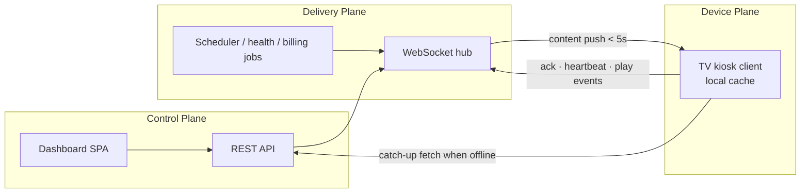

# Brandcast TV — Cloud Digital Signage Platform

A complete, multi-tenant digital signage SaaS. Turns any smart TV into a centrally
managed marketing display: pair with a 4-digit code, assign playlists, push promotions
instantly, and monitor screen health from anywhere.

Implements the Brandcast TV PRD v1.0 end to end — all three roadmap phases.

## Quick start

### With Docker (recommended)

```bash
cp .env.example .env                            # then set JWT_SECRET
docker compose --profile seed run --rm seed     # load demo data (optional)
docker compose up -d
```

Open <http://localhost:4000>. Stop with `docker compose down`, or
`docker compose down -v` to also wipe the database and uploads.

### Without Docker

```bash
npm install
npm run seed     # demo org, branches, media, playlists, schedules
npm start        # http://localhost:4000
```

| Surface | URL |
|---|---|
| Dashboard | http://localhost:4000 |
| TV player (browser kiosk client) | http://localhost:4000/tv |

### Demo accounts (password `password123`)

| Role | Email | Can do |
|---|---|---|
| Owner | owner@acme.test | Everything incl. billing |
| Admin | admin@acme.test | All except billing |
| Branch Manager | manager@acme.test | Only assigned branches |
| Content Editor | editor@acme.test | Author content, cannot publish |
| Viewer | viewer@acme.test | Read only |
| Superadmin | superadmin@brandcast.tv | Platform console (`superadmin123`) |

### See it work in 60 seconds

1. Open the **TV player** in one tab — it shows a 4-digit code with a countdown.
2. Sign in to the **dashboard** as the owner, go to **Screens → + Add New Screen**.
3. Enter the code, name the screen, pick a playlist, click **Pair & go live**.
4. The TV starts playing immediately. Change its playlist and watch it update in under a second.
5. Kill the server: the TV keeps looping from its local cache and reconnects automatically.

## Architecture

Three planes, exactly as specified in the PRD.



- **Backend**: Node + Express, SQLite (WAL), `ws` for the realtime plane. No build step.
- **Dashboard**: dependency-free ES-module SPA (`public/dashboard`).
- **TV client**: single-file browser kiosk player (`public/tv`) — the PRD's recommended
  universal client, running on Android TV, Tizen, webOS and any browser.

```
src/lib/     db · auth+RBAC · plans · hub (realtime) · content (resolution) · jobs
src/routes/  accounts · content · screens · schedules · insights · superadmin
public/      dashboard SPA · tv player
tests/       e2e.test.js (API + realtime) · ui.test.js (real DOM)
```

## Feature coverage

**Phase 1 — MVP**
- 4-digit OTP pairing with countdown, expiry and regeneration
- Add New Screen: name, branch, playlist, flash news, orientation, auto-captured metadata
- Instant push over WebSocket with per-screen Pending → Delivered → Rendered status
- Offline fallback: local cache loop, auto-reconnect, delta sync on recovery
- Unpair/re-pair with instant device-token revocation

**Phase 2 — Multi-branch & scheduling**
- Organization → Branch → Screen hierarchy with per-branch timezones and defaults
- Full RBAC (Owner, Admin, Branch Manager, Content Editor, Viewer) enforced at the API layer
- Scheduling engine: dayparting, date ranges, days-of-week, timezone-aware,
  conflict precedence (screen > branch > org) with visible warnings
- Media library (upload + CDN link, tags, folders, version history), playlist
  drag-and-drop builder with preview, flash news ticker
- Screen health monitoring, offline alerts, bulk publish, one-click rollback
- Self-serve billing: plan tiers, per-screen pricing, limits, GST-compliant invoices

**Phase 3 — Enterprise & platform scale**
- Superadmin console: tenants, suspend/restore, plan changes, MRR, platform health
- Per-org feature flags for staged rollout; audit-logged support impersonation
- Content approval workflow, media version history and restore
- TOTP 2FA (org-enforceable), SSO exchange endpoint, full audit log
- Analytics: uptime per screen/branch with CSV export, play counts and duration

## Verification

```bash
npm test    # 83 tests: 24 API/realtime + 21 feature depth + 17 non-functional + 21 UI
```

Three of the UI tests boot `app.js` itself the way a browser does, so a runtime error
in the shell fails the suite instead of silently leaving users on the loading screen.

The suite runs against a real server and a real DOM. It covers the PRD acceptance
criteria directly, including measured publish latency, offline detection and recovery,
tenant isolation, RBAC denials, plan-limit enforcement and the superadmin console.

`tests/nfr.test.js` covers the non-functional requirements: auth/signup rate
limiting, the pairing-token hardening described below, WCAG landmarks and dialog
semantics, and translation completeness across all five locales.

`tests/features.test.js` covers the paths that are easy to claim and hard to verify:
real multipart uploads with the bytes served back, version replace/restore, the
approval workflow filtering unapproved content out of the TV payload, branch-manager
scoping (including that bulk publish cannot leak across branches), branch defaults,
ticker time-boxing, password reset single-use semantics, SSO plan gating and the
billing downgrade/cancel lifecycle.

Measured against the PRD KPIs on a local run:

| KPI | Target | Measured |
|---|---|---|
| Time to pair a screen | < 2 min | ~30 ms API round trip |
| Publish-to-display latency (P95) | < 5 s | ~75 ms |

## Configuration

| Variable | Default | Purpose |
|---|---|---|
| `PORT` | `4000` | HTTP port |
| `DB_PATH` | `data/brandcast.db` | SQLite location |
| `JWT_SECRET` | dev value | **Set in production** |
| `OTP_TTL_MS` | `180000` | Pairing code lifetime |
| `OFFLINE_AFTER_MS` | `90000` | Missed-heartbeat offline threshold |
| `MAX_UPLOAD_BYTES` | `200MB` | Upload cap |
| `UPLOAD_DIR` | `uploads/` | Media storage path |
| `RATE_LIMIT_AUTH` | `10` | Login attempts per identity / 15 min |
| `RATE_LIMIT_SIGNUP` | `5` | New tenants per IP / hour |
| `DISABLE_RATE_LIMIT` | unset | Set to `1` only in tests |

## Security and accessibility

- **Rate limiting** on login, signup, password reset and pairing. Login buckets on
  IP *and* email, so one attacker cannot lock out an unrelated account, and a
  successful sign-in clears the counter.
- **Pairing tokens are device-bound.** `/api/pairing/status/:code` requires the
  caller's own `device_id`; guessing the 4-digit code alone will not surrender a
  device token.
- **WCAG 2.1 AA** on core admin workflows: skip link, `nav`/`main` landmarks,
  `aria-current` on the active route, dialogs with focus trapping and Escape-to-close,
  labelled form controls, visible focus rings, and `prefers-reduced-motion` support.
  Body text sits at 16:1 contrast and muted text at 9.7:1 (AA needs 4.5:1).
- **Localization** in English, Hindi, Tamil, Kannada and Arabic. All 15 views render
  translated, including the sign-in and invite screens, and the choice persists across
  reloads. Arabic switches the document to RTL and the stylesheet uses logical
  properties (`inset-inline-*`, `text-align:start`) so the layout mirrors correctly.
  Currency follows the organization while digit grouping follows the reader.
  91 strings cover navigation, primary actions, headings and empty states; deeper
  copy (modal field labels, table headers, validation messages) still falls back to
  English. Add a language with one block in `public/dashboard/i18n.js` — tests fail if
  a locale omits any English key or if any view stops rendering translated.

## Production notes

Deliberate choices for a runnable reference implementation, and what to swap at scale:

- SQLite → Postgres, and the in-process WebSocket hub → MQTT/Redis pub-sub for
  multi-node fan-out to tens of thousands of screens.
- Local `uploads/` → S3 + CDN (the media model already supports external URLs).
- The billing service is gateway-abstracted; wire Stripe/Razorpay webhooks to
  `/api/billing/subscribe`. No card data is ever stored.
- Set `JWT_SECRET` and terminate TLS at the edge.
- The rate limiter is in-process. Across multiple nodes, also enforce limits at the
  gateway, since each node keeps its own counters.
